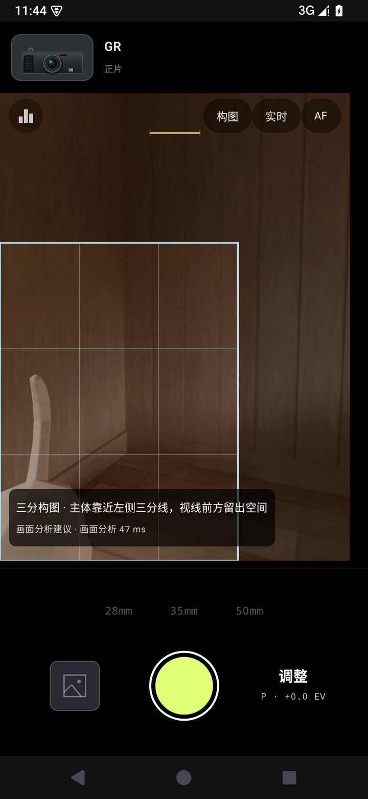
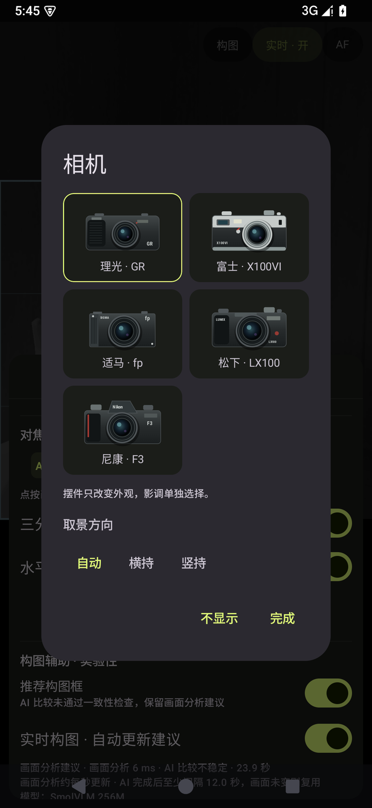
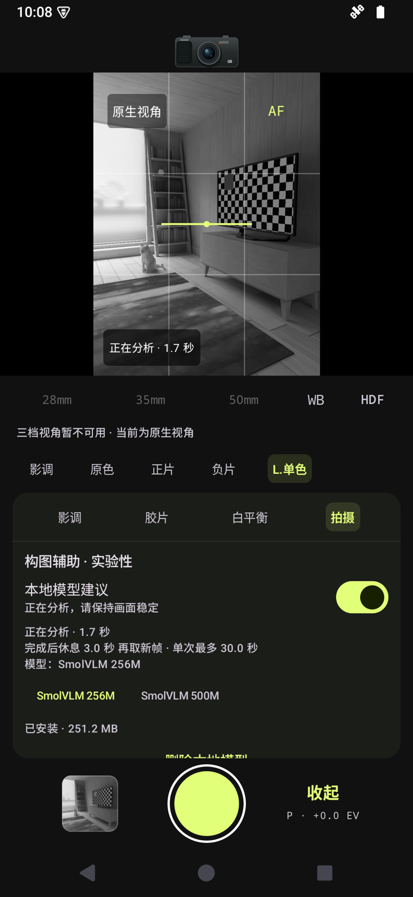
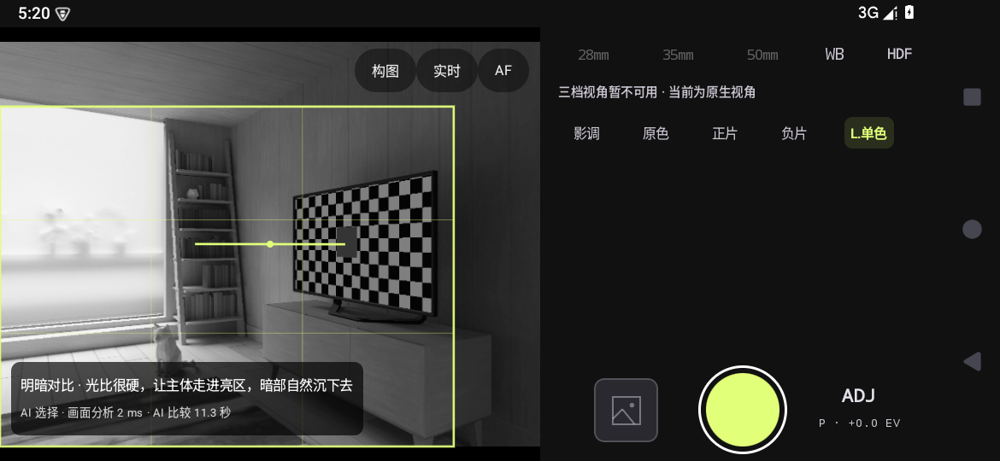

# street-snap · 途帧

喜欢口袋相机，也喜欢它们各自的脾气：熟悉的视角、顺手的快门，一眼认得出的颜色。途帧于手机之上：收束纷扰，快门轻触，影调自调。途遇，帧藏。

**Open-source Android street camera: an uncluttered camera-back viewfinder, Snap-style capture, film-inspired color, and an optional on-device composition advisor — no cloud, no account.**

[](#roadmap)
[](#安装与发布)
[](#roadmap)
[](LICENSE)
[](#技术栈)
[](#本地构图辅助实验性)

## 这是什么

途帧是一款开源 Android 街拍相机，以理光 GR 这类随身相机的就绪速度为参照：**启动快、操作少、体积轻**——手机相机功能越来越多，但街头抓拍没有时间留给菜单。途帧只保留 **28 / 35 / 50mm** 三档等效视角，把准备工作前置（预设曝光、对焦、影调并自动记忆），举机即拍；同时提供胶片气质的行色调色与一个**完全可选、全程离线**的本地构图助手。

> **Android 预览开发中，最低 Android 12。** 首测真机为荣耀 Vs3；相机能力、折叠屏与性能数据仍以真机验证为准，模拟器截图不代表实拍效果。iOS 后续启动。

## 核心能力

- **举起即拍**：快门居中、零确认、无边框打印；音量键可当快门；点按对焦、长按锁焦；照片直接写入系统相册（带 EXIF JPEG），不读取图库。
- **三档视角**：28 / 35 / 50mm 等效焦段，按设备 Camera2 能力开放，不支持的档位不点亮。
- **真实手动能力**：P / S / M 曝光档、EV、AF / MF、白平衡预设与 A–B / G–M 漂移、HDF 软件柔光；固定光圈手机不伪造 A 档。
- **行色调色**：原色、正片、负片、粉末蓝、高反差黑白、晴街等内置影调，7 套参考真实胶片型号调校的配方，支持导入 `.cube` LUT，每套影调十项参数独立微调并记忆；取景预览与成片共用同一套 3D LUT。
- **本地构图辅助（实验性、可选）**：取景器上显示推荐构图框和一句中文建议；规则层免下载直接可用，端侧模型按需下载、全程离线，不联网、不上传照片。到位后绿框反馈，右下角动态箭头提示移动方向。
- **姿势助手（实验性、可选）**：屏幕上贴合人体的火柴人骨架 + 8 个摆拍姿势的目标引导与关节级中文提示；端侧 MediaPipe 模型按需下载，无模型时内置演示模式仍可浏览全部姿势。
- 免费、无广告、无内购、无账号。

## 界面导览

| 竖屏取景与构图建议（铭牌跟随影调族） | 取景器相机：跟随影调 / 固定 / 隐藏 | 构图辅助与端侧模型管理 |
| :---: | :---: | :---: |
|  |  |  |

<p align="center">
<br>
端侧模型两轮选择一致、领先差距超过门限后，蓝框升级为黄色「AI 选择」（横屏模拟器，2026-10-19 稀有一次的采纳记录）
</p>

四张均为模拟器内置测试房间的真实 screencap，不拼景、不补造（截图说明与证据边界见 [截图说明](docs/images/README.md)）。蓝色框是画面分析（规则）建议；黄色框只在端侧模型通过门闸时出现，模型弃权、不稳定或超时则保留蓝框并在状态行如实标注（采纳证据的现状见[下文](#证据纪律)）。宽横屏（≥600dp）自动切换为侧边控制栏，单手触达。

## 最近更新（v0.3 预览）

- **相机背式取景页**：竖屏为「顶部铭牌 + 与成片同比例的 3:4 取景屏 + 实体控制簇」三段布局，中间不留黑带；80dp 铭牌让相机机身舒展可辨，焦段、快门与"调整"入口作为一组在控制簇内居中，长屏上不再出现断裂的空当。
- **铭牌跟随影调族**：顶部相机不再是独立摆件——默认随当前影调 / 胶片显示对应品牌机身（理光、富士、适马、松下；通用影调显示中性镜头标），也可固定一款或彻底隐藏；跟随态点按铭牌直达影调面板。
- **DSLR 式测光肩屏**：快门上方常驻等宽字体条，依次显示拍摄档位（P/S/M）、固定光圈、**实时快门与 ISO**（读 Camera2 真实 CaptureResult，自动档不再只显示 AUTO）、新鲜读数指示与 EV 入口；左上角小角钮只在「关闭 → 亮度直方图」之间切换，默认关闭、保持纯粹。水平仪在顶部机背刻度式位置。
- **一块控制面板**：影调、胶片配方、白平衡、P/S/M 与构图模型管理全部收进底部升起的单一面板。任何手动覆盖（非自动白平衡、MF、S/M 档、EV、柔光）都会显示一枚小药丸：点按直达对应设置，**长按一键复位**。
- **d1-omni 600M 是唯一构图模型**：规则层独立可用、模型仅作低频复核的双分支管线不变；自 2026-10-20 起 SmolVLM 256M/500M 已下架，catalog 仅保留固定 revision 的 d1-omni-600M，UI 只显示真实模型名。
- **构图建议会"动"也会"确认"**：21 类构图语言生成候选后附一句动作建议（平移/俯仰/靠近的方向与幅度），右下角动态箭头同向指引；按建议到位连续 5 帧后，推荐框转绿、出现对勾与「构图到位 · 可以拍了」。
- **姿势助手（新）**：MediaPipe 33 点人体骨架 + 8 个摆拍姿势的火柴人引导，默认提供免下载演示模式。
- **实时性提升**：规则层取景分析从约 0.87 次/秒提升到约 2.4 次/秒（模拟器实测，真机待验）；模型 session 在相机绑定前后台预热。开发者诊断面板可看真实分段计时、token 数、内存与采纳统计（TTFT 对判别式模型标注为不适用）。

完整进展见 [Roadmap](#roadmap)；界面演进的行业调研与设计取舍见 [相机 UI 调研](docs/camera-ui-research.md)，端侧细节见[构图 SOP](docs/composition-pipeline-sop.md)与[姿势助手方案](docs/pose-assistant-plan.md)。

## 行色 / Xingse

> 沿途所见，自有其色。

「行色」是调色模块，使用 **3D LUT** 调整颜色，并提供颗粒、暗角等效果；取景预览与成片共用同一套算法。

- **内置影调**：原色、正片、负片、粉末蓝、高反差黑白、晴街等，均为独立创作预设。
- **胶片配方**：VISION3 250D/500T/50D、EKTAR 100、PORTRA 400、FUJICOLOR C200、TRI-X 400 七套配方，以真实存在的胶片型号为风格参考，包装图形与参数由项目独立调校，不代表厂商原厂输出。
- **LUT I/O**：支持 SDR `.cube` 导入；导出与配方分享后续支持。
- **微调**：每套影调单独记忆饱和度、色相、对比、亮度、高光、阴影、锐度、清晰度、颗粒、暗角。
- 调色代码与预设随仓库开源（见 [独立项目声明](#独立项目声明)）。

## 本地构图辅助（实验性）

点一下取景器上的 **构图** 分析当前帧，也可以开 **实时**：规则层每秒约 2–4 次产出候选，模型低频复核。推荐框只用于帮助取景，**照片永远保存完整画面**，不会自动裁切，也不改变曝光、对焦或变焦。

### 一次建议的生命周期

```text
举起手机（快门始终独立可用，构图分析永不阻塞拍摄）
  │
  ├─ 点「构图」   → 只分析这一帧
  └─ 开「实时」   → 每 ~250ms 规则分析一帧；模型完成后冷却 3–15s，画面不变就复用
        ▼
  规则层 FastCompositionAdvisor（纯 Kotlin 图像统计，通常 1–10ms）
        ▼
  ① 立即返回：画面分析建议——一个框 + 一句中文建议，先有东西可看
        ▼
  需要模型复核吗？（低纹理 / 未装模型 → 否，流程到此结束）
        ▼ 是
  本地模型对同一帧的 A/B/C 三个候选做一次"选择题"（单并发，30s 总预算）
        ▼
  门闸：领先差距足够大？换序后选择一致？场景没变化、帧没过期？
     ├─ 全部通过 → ② 升级为「模型选择」黄框（文案仍来自规则理由，不伪造模型发言）
     └─ 任一不过 → 保持 ① 的蓝框，界面如实标注"AI 比较不稳定/超时"
        ▼
  画面明显变化 → 旧框立即失效；静止场景 → 同框同文案不重发，减少闪烁
```

关键产品原则：**先给可见建议，再做模型比较；模型任何环节失败，体验都退回到规则层而不是空白。** 模型输出的只是"A/B/C 选谁"，不直接生成坐标，框坐标始终来自 App 自己的规则层。

### 模型与下载

模型权重 **不随 APK 分发**：在"调整 → 拍摄 → 构图辅助"里显式下载、校验 SHA-256、可随时删除。当前可选目录只有 d1-omni-600M；历史 SmolVLM 记录保留在评测文档，不再出现在最新模型选择 UI：

| 模型 | 大小 | 形态 | 许可 |
| --- | --- | --- | --- |
| d1-omni-600M（默认） | 417.7MB | 视觉决策模型，marker 选择题，零生成 token | LFM Open License v1.0 |
| ~~SmolVLM 256M / 500M~~ | 历史记录 | 已从当前 catalog 下架；仅用于早期加载与失败边界对照 | 各自模型许可 |

### 工程细节

```text
CameraX ImageAnalysis（YUV → 独立 RGB 帧 + 场景签名）
        │
        ▼
FastCompositionAdvisor（Kotlin 规则，不是神经网络）
  96px 缩略图：Sobel 边缘与梯度方向直方图 · 视觉重心 · 分带能量 · 左右镜像 ·
  侧翼纹理 · 竖边普查 · 水平分界（次强边界对比）· 投影自相关节奏 ·
  Otsu 明暗双峰 · 双侧内收汇聚 · 三分位置契合 · 边缘切割风险 · 裁切信息保留率
        │ 3 个等比例合法裁切框 + 构图风格标签 + 中文理由（21 类构图语言）
        │ 强证据但能量候选缺失时，第三名补入"风格种子"裁切（如对称全帧）
        ▼
CandidateContactSheet：同一帧三个裁片拼成 A/B/C 对照图
        │ （不夹带规则分数/高亮，防止把排序泄露给模型）
        ▼
CandidateRanker —— 本地 ONNX Runtime（arm64 精简切片，约 6.7MB）
  └─ d1-omni-600M「d1 决策 600M」——当前唯一 ranker，417.7MB，q4 量化
       vision_encoder（512² / 32×32 patch）→ embed_tokens（官方 prompt.py
       选择序列）→ decision_q4 双向决策头：零生成 token，
       直接对 A/B/C 三个 marker 的 logits softmax
        ▼
CandidateSelectionGate（实验阈值 0.10，未经审美标注校准）
  top-1/top-2 概率差 · 首轮选择后换序再比一次须一致 ·
  场景/帧龄校验 · 30s 预算 · 推理忙时直接返回 null
        ▼
Compose 叠加层：框（黄=模型选择 / 蓝=画面分析）+ 中文建议 + 来源与耗时
```

### 证据纪律

模型目前的状态是 loaded-only——链路在 Android 模拟器真版权重上跑通（d1 一轮 margin 0.21 采纳、一轮超时降级均符合契约），但 70+ 站位扫测中门闸从未稳定采纳，合成探针也显示小模型存在明显的位置偏好（见 [SOP](docs/composition-pipeline-sop.md)），一次加强题面的 prompt 改版经 20 张隔离 sheet 预注册评测被否决、已回退锁定。**"能返回 A/B/C"不构成审美证据**，下一步质量证据来自独立人工标注照片集；真机速度（荣耀 Vs3）同样待验。唯一一次稳定黄框采纳来自已下架的 SmolVLM 256M 在 Android 15 模拟器横屏的稀有事件、不可复现，d1 与竖屏尚未观察到，真机命中率以荣耀 Vs3 实测为准。详见 [端侧构图建议 SOP](docs/composition-pipeline-sop.md) 与 [端侧模型附录](docs/edge-model-plan.md)。

## 三仓库协同

途帧主应用与组织内两个研究仓库协同演进，各自保持清晰边界：

- [edge-model-solutions](https://github.com/light-witness-lab/edge-model-solutions)：端侧模型组合、场景 SOP、模型 provenance、评测与失败记录。
- [inference-engineering](https://github.com/light-witness-lab/inference-engineering)：运行时、量化、算子覆盖、调度、内存、温升与推理优化研究。
- `street-snap`（本仓库）：相机 UI、取景生命周期、模型适配、APK 和设备实测。

当前 d1 证据等级仍为 `loaded-only`；荣耀 Vs3 真机性能、温升与审美质量保持 `not-verified`。三仓库的交接字段和更新顺序见方案库的 [三仓库地图](https://github.com/light-witness-lab/edge-model-solutions/blob/main/docs/three-repository-map.md)。

## 安装与发布

**Android 版可安装，最低 Android 12。** 体验最新代码：打开组织仓库的 [Actions → Android CI](https://github.com/light-witness-lab/street-snap/actions/workflows/android.yml)，选一次成功运行，在摘要下载 **Preview APK**（制品保留 30 天，需登录 GitHub）。CI 包包名独立、显示「途帧 CI」，可与正式版并存。

Preview 是开发测试签名的非调试构建（启用 R8 与资源裁剪，约 57MB，不含模型权重——构图与姿态模型均在 App 内按需显式下载）。覆盖安装同签名版本可保留拍摄参数。本地构建见 [Android 开发说明](docs/android-development.md)，CI 与签名发布见 [CI 与版本发布](docs/ci-and-releases.md)。**iOS** 后续开发。

```sh
# JDK 17 + Android SDK（compileSdk 37）
./gradlew :app:assemblePreview
# 产物：app/build/outputs/apk/preview/app-preview.apk
```

## Roadmap

- [x] Android 基础拍摄：取景、拍照、28/35/50mm、参数记忆、实时影调、LUT 导入、EXIF JPEG
- [x] 手动能力：P/S/M、EV、AF/MF、白平衡漂移、HDF 柔光；设备不支持的档位不显示
- [x] 取景器改造：竖屏相机背式三段布局（铭牌 + 3:4 屏 + 实体控制簇，无 letterbox 黑带）、控制面板收纳进底部浮层、手动覆盖可见且可一键复位（行业调研见 [camera-ui-research.md](docs/camera-ui-research.md)）
- [x] 双分支构图管线：规则层独立可用 + d1-omni 600M 端侧复核（SmolVLM 已下架），含换序一致性门闸、动作建议、对齐绿框与背压场景失效契约
- [x] 姿势助手：MediaPipe 端侧骨架 + 8 姿势引导，无模型时演示模式可用（真机贴合度待验）
- [ ] 构图质量：独立人工标注照片集，评估规则首选与模型重排的真实偏好改善
- [x] 性能：连续串行推理，规则层模拟器实测约 2.4 次/秒（0.87 → 2.4）；真机帧率、温升与功耗待 Vs3
- [ ] 设备验证：荣耀 Vs3 真机、折叠屏、预览与成片一致性
- [ ] 高级控制：RAW/DNG、峰值对焦、配方分享与导出
- [ ] iOS：复用产品交互与配方规范

## 技术栈

| 部分 | 方案 |
| --- | --- |
| Android | Kotlin 2.2.10 + Jetpack Compose + CameraX / Camera2 interop |
| 模块 | `app`（交互/保存/构图）· `camera`（相机会话与帧管线）· `color`（LUT 与 GPU 效果） |
| 调色 | OpenGL ES 3.0 / GLSL，预览与成片共用 |
| 规则构图 | Kotlin 图像统计（积分图/Sobel/方向普查/自相关/Otsu/弱峰主体 BFS/三层景深），21 类构图语言 |
| 端侧推理 | ONNX Runtime 1.22（arm64 裁剪 AAR），d1-omni-600M 按需下载；姿态用 MediaPipe Tasks Vision 1.1.1（lite 模型按需下载） |
| iOS（后续） | Swift + SwiftUI + AVFoundation / Metal |
| 预设文件 | `.cube` + JSON |

## Contributing

欢迎通过 Issue 讨论、PR 贡献：相机原生接入与设备适配（Camera）、独立创作的 LUT 与影调配方（Color）、单手操作与取景体验（UX & Docs）、真机试拍反馈（Device testing）。提交影调预设请附创作说明与许可信息，请勿提交原厂固件提取的色彩文件或无权再分发的第三方 LUT。

## 独立项目声明

途帧是摄影爱好者发起的独立开源项目，与理光、富士、适马、松下、柯达等厂商无关联、隶属或授权关系。内置影调与胶片配方均为独立创作，仅以真实胶片型号作为风格参考，不代表原厂成像效果；文中商标归各自权利人所有。

## 开源协议与名称使用

项目代码与内置影调预设采用 [MIT License](LICENSE)，允许在保留版权与许可声明的前提下使用、修改、分发及商业使用；第三方素材（端侧模型权重、ONNX Runtime）按各自许可分发。MIT 不授予「途帧」「street-snap」名称与标识的商标权，请勿抢注或冒用官方身份。
